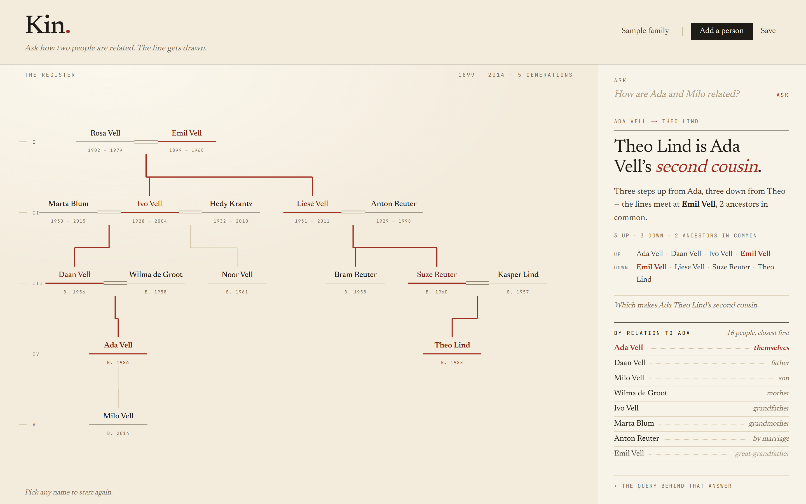

# Kin

**Ask how two people are related. Watch the line get drawn.**

Kin is a family chart that runs entirely inside a browser tab. You type
*"how are Milo and Theo related?"* and it answers **second cousin once
removed** — then traces the actual path through the graph, in vermilion, from
one name up to the ancestor the two of them share and back down the other side.



## Why this needs a graph database

The answer *is* a path. "Second cousin once removed" is not a field you can
store on a person: it is a function of two numbers you only get by walking
parent links — how far up from each person the two lines meet, and how far back
down. Every question in this app is that walk:

```cypher
MATCH up   = (a:Person {id: $a})<-[:PARENT*0..6]-(ca:Person)
MATCH down = (ca)-[:PARENT*0..6]->(b:Person {id: $b})
RETURN ca.id AS ancestor, length(up) AS up, length(down) AS down,
       [n IN nodes(up) | n.id]   AS upIds,
       [n IN nodes(down) | n.id] AS downIds
ORDER BY up + down ASC, abs(up - down) ASC, ancestor ASC
LIMIT 1
```

Add one person to the chart and every answer changes, because nothing is
precomputed. The app also answers the questions that have no shared ancestor at
all — a tie by marriage is a path through a partnership, and it names the blood
relation on the other side of it ("Wilma is married to Daan, and Suze is
Daan's first cousin").

## Why it runs in the tab

A family tree is the most personal data most people own. It should not need an
account, a server, or a terms-of-service page. So the whole database is
[Relate](https://relatedb.ai) compiled to WebAssembly: an embedded,
in-process graph engine. Open the page, the engine is already there. Nothing is
fetched — the end-to-end test asserts that the page makes **zero** non-local
requests.

## Run it

```bash
npm ci
npm run dev          # http://localhost:4321
```

Or the built bundle, which is what gets judged:

```bash
npm run build
npm run preview      # http://localhost:4321
```

Everything, from a clean clone to the verdict:

```bash
bash scripts/verify.sh
```

That runs the type check, 72 unit tests, the build, 14 browser checks against
the built bundle, and the UI measurement. Exit code is the answer.

## What it does

- **Two names, one question.** Click any two people, or type the question.
  You get the kinship term, which ancestor the lines meet at, how many
  generations each side, and how many ancestors are shared.
- **One name is already a question.** Pick anybody and the index turns into
  *everyone, by relation* — all fifteen other people in the chart, each with
  their kinship term, closest first. Pick a row to ask about that pair.
- **The answer is drawn.** The path lights up in vermilion, and the card splits
  it into two legs — the climb up to the shared ancestor, and the climb down to
  the other person. The rest of the chart stays in ink.
- **Half is not full.** Siblings who share one parent are named half-siblings —
  but only when the chart actually records two parents for each of them.
  With less information, Kin says "sister" rather than invent a claim.
- **Marriage is not blood.** When there is no shared ancestor, Kin walks the
  partnerships and names the blood tie on the far side.
- **One name is a question too.** "Who is Ada's mother" lists parents,
  children and partners.
- **Editable.** Add a person with a mother, a father and a partner; the chart
  re-lays itself out and every answer is re-derived. Save the chart as JSON,
  drop it back in to restore.
- **The query is on screen.** Under every answer there is a disclosure with the
  exact Cypher that produced it and how long it took.

## The chart that ships with it

Sixteen invented people, five generations, built so every kind of answer has
something to point at: an aunt, a half-sister, a twice-married man, second
cousins at two different depths, and one tie that exists only by marriage.
Nobody in it is real.

## How it is put together

| Path | What lives there |
| --- | --- |
| `src/kinship.ts` | Naming a relationship from two integers. No imports, so it can be tested to death. |
| `src/relatives.ts` | Every question, and the Cypher that answers it. |
| `src/layout.ts` | Generations → couples → order by barycentre → centre children under parents. A chart, not a hairball: no force simulation anywhere. |
| `src/render.ts` | The printed-pedigree look: names on hairline rules, one colour for the answer. |
| `src/db.ts` | The embedded engine, opened once. |
| `src/ask.ts` | A pattern match, not a model: the chart is a closed world. |
| `src/main.ts` | Wiring. |

Relate features in use: embedded WebAssembly engine with no server, openCypher
(`MATCH`, variable-length paths, `shortestPath`, `length()`, `nodes()`,
`MERGE`, pattern of property indexes).

## Licence

MIT. See [LICENSE](LICENSE).
